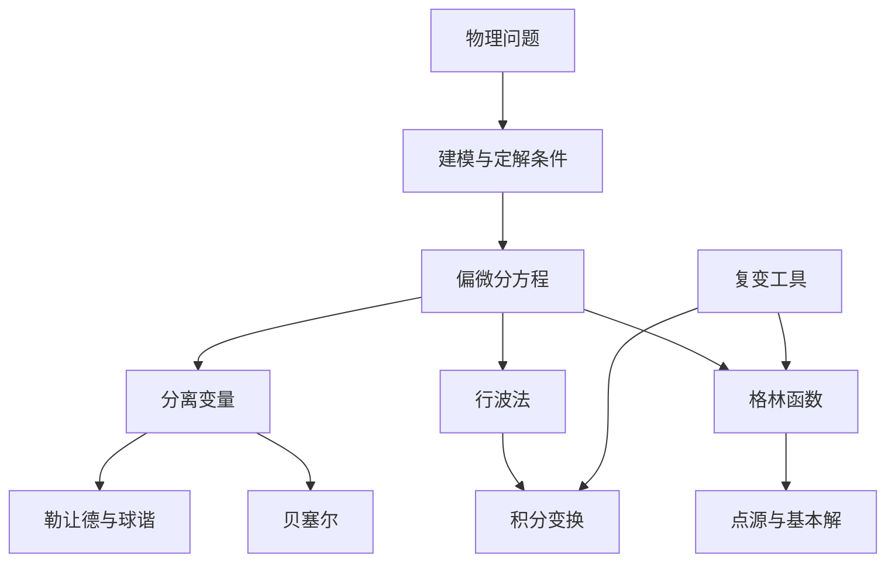

# 数学物理方法 · 学习总览

这是一套**已填充的零基础精讲版**：十四章正文、61 个概念详解、5 个高难概念的第一性原理推导、100 道测验题与 120 张抽认卡都已写入。结构和依赖关系没有改动，填充只在原有骨架里加内容。

## 这门课在解决什么

物理里的弦振动、热传导、静电场，写成偏微分方程之后怎么解。整条主线只有一句：**先把问题化成"方程 + 定解条件"，再用四种武器求解**。

| 武器 | 用在哪 | 对应章节 |
|---|---|---|
| 分离变量 | 有界区域、边界是坐标面 | 第 8 章，配第 11、12 章的特殊函数 |
| 行波法 | 无界或半无界的波动问题 | 第 9 章 |
| 积分变换 | 初值问题、半无界扩散 | 第 5、6、9 章 |
| 格林函数 | 有源问题，点源响应叠加 | 第 10 章 |

复变函数（第 1–4 章）不是独立的故事，它是留数、逆变换、保角映射的弹药库。

## 十四章结构

| 章 | 主题 | 难度 | 学时 | 前置 | 学完的产出 |
|---|---|---|---|---|---|
| 0 | 开课前的数学工具箱 | ★☆☆ | 6 | 无 | 四件工具练熟 |
| 1 | 复数与复变函数 | ★☆☆ | 4 | 0 | 能在复平面运算、画分支 |
| 2 | 解析函数 | ★★☆ | 6 | 1 | 会用柯西–黎曼方程 |
| 3 | 复变积分 | ★★☆ | 5 | 2 | 会用柯西定理与公式 |
| 4 | 级数展开与留数 | ★★★ | 8 | 3 | 会算留数与三类实积分 |
| 5 | 傅里叶变换 | ★★☆ | 6 | 0 | 会变换对与卷积定理 |
| 6 | 拉普拉斯变换 | ★★☆ | 4 | 0 | 会解初值问题 |
| 7 | 方程的建立与定解条件 | ★★☆ | 4 | 0 | 能导出三类方程 |
| 8 | 分离变量法 | ★★★ | 10 | 7 | 能完整走完五步 |
| 9 | 行波法与积分变换法 | ★★☆ | 5 | 7、8 | 会达朗贝尔与延拓 |
| 10 | 格林函数法 | ★★★ | 6 | 7、8 | 会镜像法与推迟格林函数 |
| 11 | 勒让德多项式与球谐 | ★★★ | 6 | 8 | 会球坐标分离与展开 |
| 12 | 贝塞尔函数 | ★★★ | 6 | 8 | 会柱坐标分离与展开 |
| 13 | 变分法初步 | ★★☆ | 4 | 0 | 会推欧拉–拉格朗日方程 |

合计 80 学时，按每周 5 小时算，一学期刚好。

## 依赖关系怎么读

打开「知识图谱」页，每个节点是一个概念，箭头指向前置。读图的顺序不是从左到右，而是**从没有入边的节点开始**：`c001`（偏导）、`c003`（级数）、`c101`（复数）是三个源头，它们没有前置。

几条关键长链：

- `c101 → c102 → c201 → c202 → c203`：复平面 → 极限 → 解析 → 柯西–黎曼 → 调和函数
- `c201 → c303 → c401 → c402 → c403 → c404`：解析 → 柯西公式 → 泰勒 → 洛朗 → 留数 → 实积分
- `c702 → c801 → c802 → c804 → c1103 → c1104`：边界 → 分离 → 本征值 → 正交 → 球谐
- `c504 → c1001 → c1002/c1003`：δ 函数 → 基本解 → 镜像法/推迟势

## 学习路径（四个阶段）

**第一阶段：工具（约 10 小时）**
第 0 章 → 第 1、2 章。目标是能在复平面上自由运算，并且会用柯西–黎曼方程判断解析性。这一段不要跳，后面所有计算都踩在这里。

**第二阶段：复变与变换（约 23 小时）**
第 3、4 章 → 第 5、6 章。目标是会把闭路积分变成留数，会把微分方程变成代数方程。第 4 章最花时间，留数算实积分要动手算到不查表为止。

**第三阶段：方程与解法（约 25 小时）**
第 7、8 章 → 第 9、10 章。目标是完整走完"建模 → 定解 → 分离变量 → 定系数"。第 8 章是分水岭，非齐次项处理不过关，后面特殊函数也学不进去。

**第四阶段：特殊函数与收口（约 16 小时）**
第 11、12 章 → 第 13 章。目标是看到球坐标、柱坐标就知道本征函数是谁，能用变分法重写本征值问题。

## 零基础缺口

| 缺口 | 补讲位置 | 学完标志 |
|---|---|---|
| 多元微积分生疏 | 第 0 章 c001 | 能独立验证 $u_{tt}=a^2u_{xx}$ |
| 常微分方程忘光 | 第 0 章 c002 | 三种特征根都能写通解 |
| 级数与收敛半径 | 第 0 章 c003 | 能说出收敛圆为什么由最近奇点决定 |
| 矢量分析没学过 | 第 0 章 c004 | 能把 $\nabla\cdot\vec A$ 写成坐标分量 |
| 复变零基础 | 第 1 章 | 能画点、算乘法、画分支切割 |

## 这一版怎么用

1. 先读章节页，知道这一章在整条链上的位置、要攻哪几个难点。
2. 概念页当索引卡：定义、核心结论、常见误解，三条扫一遍，再回章节页做检查点。
3. 概念页顶部有前置链接，答不上检查点时沿着前置链往回走，不要原地硬背。
4. 学习路径页记录进度，每步过了检查点再往下。
5. 诊断测试随机抽题，答错会倒推到根因概念——这是查"到底哪一层没懂"用的，不是考试。

## 这一版的边界

- 每章正文按"问题—目标—核心—零基础讲解—图示—类比实例—误解—自测—锚点"组织，2500–4900 字；难点章（留数、分离变量、格林函数、球谐、贝塞尔）更长。
- 每个概念页在原有四块之后加了"详解"：白话解释、一个能验算的小例子、与相邻概念的区别。
- 深度推导只给五个卡点概念：c403 留数、c802 本征值、c1001 基本解、c1101 球坐标分离、c1201 柱坐标分离。其余概念不挂深度片段，避免全书读不动。
- 测验每章 7–8 题、抽认卡每章 8–9 张，全部带答案与解析；数值答案逐题算过。
- 内容不绑定某一本教材，主线是通用的"复变 → 积分变换 → 数理方程 → 特殊函数 → 变分法"。
