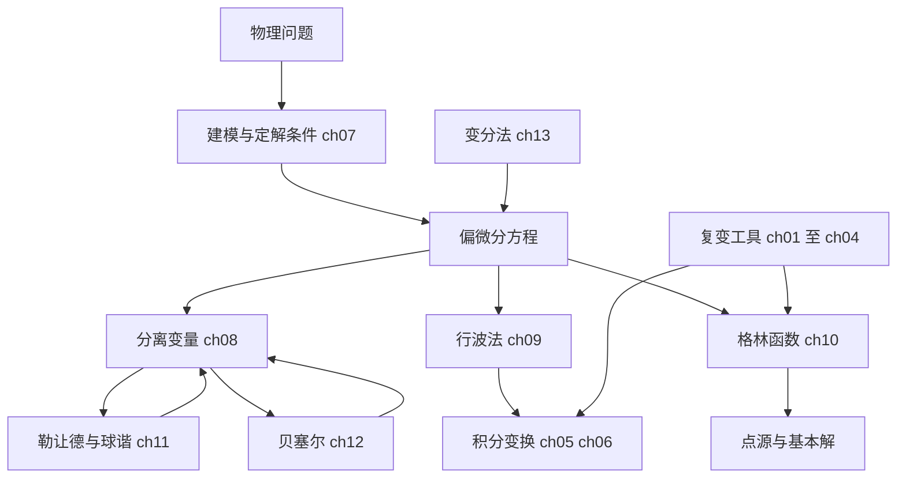

# 数学物理方法点化学习系统

## 这个主题在讲什么

它回答一个问题：物理里的弦振动、热传导、静电场，写成偏微分方程之后，怎么解。

主线只有一句：先把物理问题化成"方程 + 定解条件"，再用四种武器求解——分离变量（配特殊函数）、行波法、积分变换、格林函数。复变函数与积分变换是这四种武器的弹药库。

## 全书心智模型

看图说明：横着看是"问题 → 方程 → 三种解法"；竖着看是工具层（复变、变换）支撑解法层。特殊函数不是独立章节，它们是分离变量在球坐标、柱坐标里的必然产物。

## 学习路径（推荐顺序）

| 步骤 | 章节 | 主题 | 前置 | 检查点 |
|---|---|---|---|---|
| 01 | ch00 | 开课前的数学工具箱 | 无 | 能算二阶偏导、写常微分通解、判收敛半径 |
| 02 | ch01 | 复数与复变函数 | ch00 | 会复平面运算，能画分支切割 |
| 03 | ch02 | 解析函数 | ch01 | 会用柯西–黎曼方程判断解析性 |
| 04 | ch03 | 复变积分 | ch02 | 会用柯西定理与积分公式 |
| 05 | ch04 | 级数展开与留数 | ch03 | 会算三类留数与实积分 |
| 06 | ch05 | 傅里叶变换 | ch00 | 会变换对与卷积定理解方程 |
| 07 | ch06 | 拉普拉斯变换 | ch00 | 会把初值问题解成代数方程 |
| 08 | ch07 | 方程的建立与定解条件 | ch00 | 能导出三类方程、写对条件 |
| 09 | ch08 | 分离变量法 | ch07 | 能完整走完五步并定系数 |
| 10 | ch09 | 行波法与积分变换法 | ch07、ch08 | 会达朗贝尔公式与延拓 |
| 11 | ch10 | 格林函数法 | ch07、ch08 | 会镜像法与推迟格林函数 |
| 12 | ch11 | 勒让德与球谐 | ch08 | 会球坐标分离与球面展开 |
| 13 | ch12 | 贝塞尔函数 | ch08 | 会柱坐标分离与傅里叶–贝塞尔展开 |
| 14 | ch13 | 变分法初步 | ch00 | 会推欧拉–拉格朗日方程 |
| 15 | 综合 | 从建模到求解走完整条链 | 全部 | 独立完成一个物理场景 |

## 章节索引

- 第 0 章 开课前的数学工具箱（★☆☆）→ chapters/ch00.md
- 第 1 章 复数与复变函数（★☆☆）→ chapters/ch01.md
- 第 2 章 解析函数（★★☆）→ chapters/ch02.md
- 第 3 章 复变积分（★★☆）→ chapters/ch03.md
- 第 4 章 级数展开与留数（★★★）→ chapters/ch04.md
- 第 5 章 傅里叶变换（★★☆）→ chapters/ch05.md
- 第 6 章 拉普拉斯变换（★★☆）→ chapters/ch06.md
- 第 7 章 方程的建立与定解条件（★★☆）→ chapters/ch07.md
- 第 8 章 分离变量法（★★★）→ chapters/ch08.md
- 第 9 章 行波法与积分变换法（★★☆）→ chapters/ch09.md
- 第 10 章 格林函数法（★★★）→ chapters/ch10.md
- 第 11 章 勒让德多项式与球谐函数（★★★）→ chapters/ch11.md
- 第 12 章 贝塞尔函数（★★★）→ chapters/ch12.md
- 第 13 章 变分法初步（★★☆）→ chapters/ch13.md

## 前置知识（零基础缺口补讲）

| 缺口 | 补讲位置 | 学完标志 |
|---|---|---|
| 多元微积分生疏 | 第 0 章 c001 | 能独立算出 $u_{tt}=a^2u_{xx}$ 的验证 |
| 常微分方程忘光 | 第 0 章 c002 | 三种特征根情况都能写通解 |
| 级数与收敛半径 | 第 0 章 c003 | 能说出收敛圆为什么由最近奇点决定 |
| 矢量分析没学过 | 第 0 章 c004 | 能把 $\nabla\cdot\vec A$ 写成坐标分量 |
| 复变函数零基础 | 第 1 章 | 能在复平面画点、算乘法、画分支切割 |

## 术语表 / 模式库 / 速查表 入口

- 术语表：页面左侧「术语表」，63 条，按章可筛
- 模式库：五套解题流程（留数算积分、分离变量五步、非齐次三招、格林函数构造、特殊函数展开）
- 速查表：公式与判断规则，考试前翻一遍

## 这份材料的阶段说明

当前是**框架版**：章节结构、概念依赖图、学习路径、术语与公式索引已经完整，概念页给到"定义 + 位置 + 核心结论 + 常见误解"的密度。逐章零基础精讲与高难概念的第一性原理推导，在后续版本里往 `chapters/*.md` 与 `concepts/*-depth.md` 追加，不动结构。
